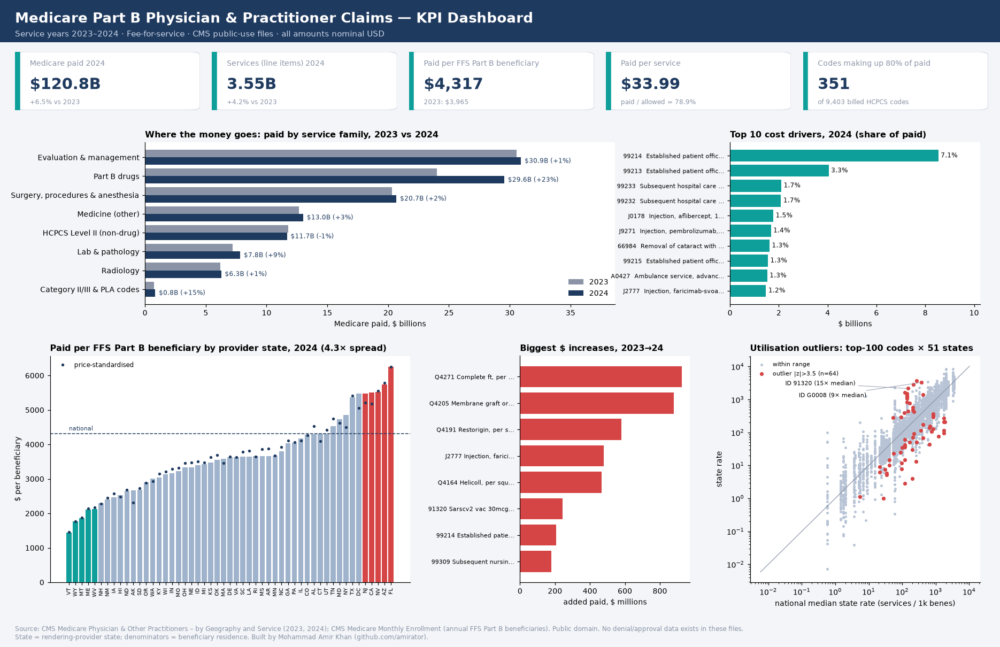

# Medicare Claims KPI Dashboard: cost drivers, state variation and outliers

**DuckDB SQL star schema, pytest data checks, and Power BI / Tableau-ready exports built on 536,984 rows of real CMS Medicare Part B claims aggregates (2023-2024).**
The KPIs are the ones a health-insurer BI team reports: paid amount, cost per member, cost drivers, regional variation and utilisation outliers.



Exports: [PNG](reports/dashboard.png) · [PDF](reports/dashboard.pdf) · [self-contained HTML](reports/dashboard.html) · [kpis.json](reports/kpis.json)

## Problem and business questions
A medical-claims analytics team at a payer (for example a KSA insurer reporting to CHI) needs a repeatable KPI layer to answer:
1. How much did we pay, for how many services, and how fast is it growing?
2. What is the cost per covered member, and how is it trending?
3. Which services drive cost, and how concentrated is spend?
4. Which regions cost more per member, and is that price or utilisation?
5. Which region × service combinations are statistical outliers worth a utilisation review?
6. Approval/denial rates: **not answerable with this data.** CMS publishes only paid (adjudicated) claims, so no denial KPI was invented.

## Headline findings (2024 service year, generated from `reports/kpis.json`)
| # | Finding | So what |
|---|---|---|
| 1 | Medicare paid **$120.8B** for 3.55B physician/practitioner services, **+6.5%** on 2023 ($113.5B); services grew +4.2%. | Spend grew faster than volume, so mix and intensity (not only volume) are driving cost. |
| 2 | Paid per FFS Part B beneficiary was **$4,317** (+8.9% vs $3,965) across 28.0M beneficiaries. | This is a PMPY-style cost-per-member figure, the core trend KPI for pricing and reserving. |
| 3 | **351** of 9,403 billed codes made up 80% of paid. The top 10 codes are 21.8%, and 99214 (established office visit) alone is 7.1% ($8.53B). | Cost-containment work can focus on a few hundred codes. |
| 4 | Part B drugs were **24.5%** of paid ($29.6B). Skin-substitute codes (Q4100-Q4399) rose from $3.45B to **$7.85B**, about 60% of the whole year-on-year increase. Q4271 (Complete ft, per square centimeter) alone went from $4.9M to $931M. | One fast-growing product category can dominate the growth. This is a classic payment-integrity watch-list item. |
| 5 | Paid per beneficiary by provider state ranges **4.3×**, from Florida ($6,258) to Vermont ($1,443). After CMS price standardisation the spread is still 4.3×. | Regional variation is mostly utilisation and patient flow, not local price levels, so network and utilisation management matter more than tariffs. |
| 6 | **64** state × code cells across 45 of the top-100 codes are robust-z outliers (abs(z) > 3.5). The largest is ID 91320 (Sarscv2 vac 30mcg trs-suc im) at **14.7×** the median state rate. | These are review candidates, not findings of wrongdoing. Billing patterns such as mass immunisers registered in one state could explain some of them. That is not tested here. |

All findings are descriptive and correlational.

## Data and licence
Publisher: Centers for Medicare & Medicaid Services (CMS), Office of Enterprise Data and Analytics. Licence: U.S. federal government work, public domain (data.cms.gov accessLevel=public; no copyright restrictions).

| Dataset | Links | Bytes | SHA-256 |
|---|---|---|---|
| Medicare Physician & Other Practitioners - by Geography and Service (2023 service year) | [landing](https://data.cms.gov/provider-summary-by-type-of-service/medicare-physician-other-practitioners/medicare-physician-other-practitioners-by-geography-and-service) · [file](https://data.cms.gov/sites/default/files/2025-04/3b718a11-a28d-4c38-a13b-2c6eeb649980/MUP_PHY_R25_P05_V20_D23_Geo.csv) | 42,062,039 | `0b569cf2b66f84eb…` |
| Medicare Physician & Other Practitioners - by Geography and Service (2024 service year) | [landing](https://data.cms.gov/provider-summary-by-type-of-service/medicare-physician-other-practitioners/medicare-physician-other-practitioners-by-geography-and-service) · [file](https://data.cms.gov/sites/default/files/2026-05/e534c74b-79b8-4892-8a95-5a17e2dfec9f/MUP_PHY_R26_P05_V10_D24_Geo.csv) | 42,078,094 | `c26956788333d03c…` |
| Medicare Monthly Enrollment (July 2026 release; annual state rows used) | [landing](https://data.cms.gov/summary-statistics-on-beneficiary-enrollment/medicare-and-medicaid-reports/medicare-monthly-enrollment) · [file](https://data.cms.gov/sites/default/files/2026-10/c41a8ac2-8229-4f3b-a4cb-423d9cd5328a/Medicare%20Monthly%20Enrollment%20Data_July%202026.csv) | 215,907,430 | `ff2dd7d2b255b275…` |

Full checksums and download times (UTC) are in [`data/manifest.json`](data/manifest.json). Raw files are downloaded by script and kept out of git.

**What this data is:** real CMS aggregates of Medicare fee-for-service Part B physician/practitioner claims, one row per geography × HCPCS code × place of service. It is not synthetic and it is not member-level.

## Data issues found while profiling
- **Suppression:** CMS drops state cells with fewer than 11 beneficiaries, so state rows total 1.4% less paid than the national rows. National KPIs therefore use the national rows (tested).
- **Blank geography:** 5 state-level rows per release have no state code or name. They are kept as `ZZ / Unspecified` and pinned in a test.
- **No claim or denial counts:** `Tot_Srvcs` counts service line units (drug codes count billing units such as per-mg), not claims. "Services" is not "claims".
- **Beneficiaries are not additive** across codes. Cost per member therefore uses the CMS Medicare Monthly Enrollment FFS Part B count as denominator. The enrollment file uses `*` for suppressed cells (parsed as NULL).
- **Geography mismatch:** claims are by rendering-provider state, enrollment by beneficiary residence. States with snowbirds or cross-border referral centres (e.g. FL, DC) can look high.
- Non-state geographies (territories, armed forces, foreign, unknown) are kept in the model but excluded from state rankings.

## Approach
```
CMS CSVs (3) ──► sql/01_staging.sql  typed, renamed, unioned 2023+2024
             ──► sql/02_star.sql     dim_year, dim_state, dim_hcpcs (+service family), dim_place_of_service
                                     fct_service (state grain), fct_service_national, fct_enrollment
             ──► sql/03_kpis.sql     kpi_national_year, kpi_family_year, kpi_top_hcpcs (RANK, running share, YoY),
                                     kpi_state_year, kpi_outliers (median/MAD robust z), kpi_pos_year
             ──► reports/kpis.json ─► dashboard (PNG/PDF/HTML) + README (this file is generated)
             ──► powerbi/*.csv + measures.dax     tableau/claims_extract.csv + BUILD_NOTES.md
```

| Table | Rows |
|---|---|
| stg_phys | 536,984 |
| stg_enrollment | 118 |
| dim_state / dim_hcpcs | 62 / 9,709 |
| fct_service | 510,143 |
| fct_service_national | 26,841 |
| fct_enrollment | 114 |

## KPI definitions
| KPI | Definition |
|---|---|
| Paid | Σ (Tot_Srvcs × Avg_Mdcr_Pymt_Amt). Medicare's payment after deductible and coinsurance |
| Allowed / Submitted | same with Avg_Mdcr_Alowd_Amt / Avg_Sbmtd_Chrg. Paid/allowed = 78.9%, charges = 3.24× allowed |
| Paid per service | Paid / services ($33.99) |
| Paid per FFS Part B beneficiary | Paid / annual Original Medicare Part B enrollees (national or state) |
| Price index | Paid / standardised amount (CMS removes geographic pricing adjustments). Above 1 means a high-price area |
| Cost concentration | number of codes whose cumulative paid reaches 80% (window function) |
| Outlier | for the top-100 codes by 2024 paid: state services per 1,000 FFS Part B beneficiaries, robust z = 0.6745·(ln x − median)/MAD across 51 jurisdictions, flagged at abs(z) > 3.5 |

## Power BI and Tableau
- `powerbi/`: star-schema CSVs (full detail, not sampled), [`measures.dax`](powerbi/measures.dax) mirroring the SQL, and relationship notes in [`powerbi/README.md`](powerbi/README.md). The dashboard image is a Power BI-style render made in Python, not a Power BI screenshot, and no .pbix is included.
- `tableau/`: a Tableau Public-ready flat extract (top-500 codes + "Other" roll-ups, reconciles to the fact table) and [build notes](tableau/BUILD_NOTES.md). **It has not been published to Tableau Public**, because that needs the author's own sign-in.

## Reference repos studied (and what was borrowed)
| Repo | Borrowed |
|---|---|
| [priyasg16/healthcare-claims-denial-analysis](https://github.com/priyasg16/healthcare-claims-denial-analysis) | Uses CMS provider data in a star schema with submitted-vs-paid variance and geographic benchmarking. Borrowed the charge-to-allowed and state benchmark KPIs. |
| [sana1410/RCM](https://github.com/sana1410/RCM) | Layered bronze/silver/gold modelling and a payer KPI list. Borrowed the staging → star → KPI layering, and dropped its denial-rate KPI because this data has no denials. |
| [vigneshwari2408/healthcare-claims-analytics-dashboard](https://github.com/vigneshwari2408/healthcare-claims-analytics-dashboard) | "The problem" framing and an overview → drill-down page plan. Borrowed the business-question-first README and page structure. |
| [CharRich926/healthcare-data-analytics-portfolio](https://github.com/CharRich926/healthcare-data-analytics-portfolio) | Explicit data-provenance disclaimer and named DAX measures (YoY, rate measures). Borrowed the DAX naming and the honesty note about what the data is and is not. |
| [dbt-labs/jaffle_shop_duckdb](https://github.com/dbt-labs/jaffle_shop_duckdb) | Layered SQL on DuckDB with tests at each layer. Borrowed the numbered SQL layers and data tests on keys and relationships. |

## Reproduce
```bash
python3 -m venv .venv && . .venv/bin/activate
pip install -r requirements.txt      # exact pins
python run.py                        # download (~300 MB, checksum-verified) → SQL → exports → dashboard → README → pytest
```
Tested on Python 3.13. A clean-venv rebuild produced byte-identical `kpis.json`.

## Tests
`tests/test_data_quality.py` checks: manifest checksums, row counts pinned to the CMS files, unique grain, foreign keys, paid ≤ allowed, the CMS <11 suppression rule, state ≤ national totals, the documented blank-state anomaly, enrollment coverage, family shares summing to 1, recomputed KPIs, a Tableau extract that reconciles, GitHub-safe file sizes, and README numbers matching `kpis.json`.

## Limitations
- Medicare FFS Part B (US, mostly aged 65+) is a proxy. Utilisation and price levels differ greatly from KSA private/CCHI-regulated insurance, so the method transfers, not the numbers.
- The data is aggregated (no member, claim or provider IDs). Outlier detection is at state × code level, not provider level.
- There are no approval, denial, rejection or turnaround fields, so those KPIs are deliberately absent.
- Only two annual points, so growth figures are YoY in nominal USD with no inflation adjustment and no seasonality.
- Service units for drug codes are billing units, so "paid per service" mixes units across code types.

## Author
Amir Khan · [github.com/amirator](https://github.com/amirator). This is a personal portfolio project, not affiliated with CMS or any insurer.
